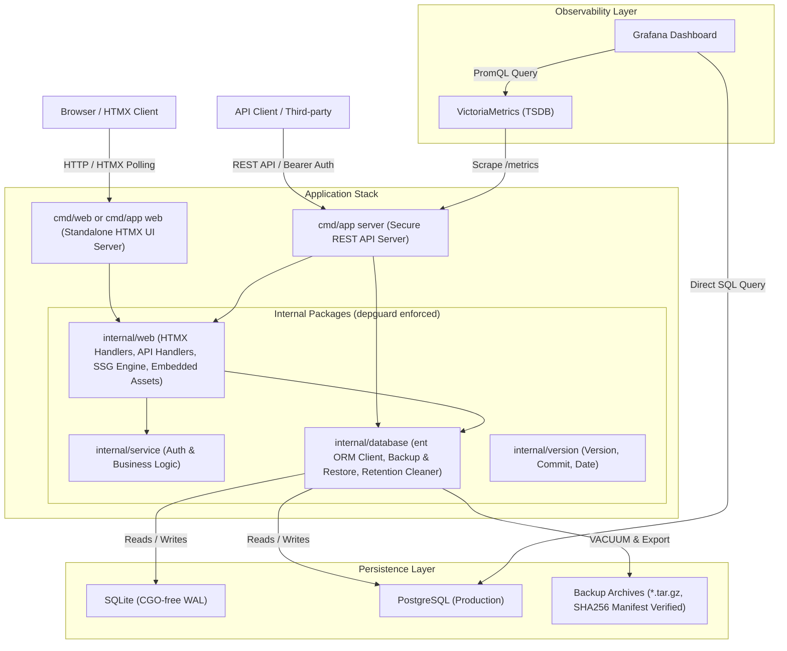
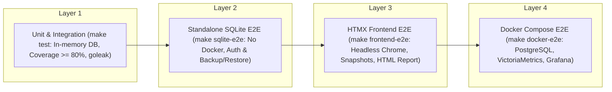

<!--
Copyright 2026 [Copyright Holder]

Licensed under the Apache License, Version 2.0 (the "License");
you may not use this file except in compliance with the License.
You may obtain a copy of the License at

    http://www.apache.org/licenses/LICENSE-2.0

Unless required by applicable law or agreed to in writing, software
distributed under the License is distributed on an "AS IS" BASIS,
WITHOUT WARRANTIES OR CONDITIONS OF ANY KIND, either express or implied.
See the License for the specific language governing permissions and
limitations under the License.

Author: [YOUR_NAME]
-->

# System Architecture & Technical Specifications

本書は、`go_template` のシステム全体アーキテクチャ、コンポーネント構成、データフロー、およびテスト階層について詳述します。

---

## 1. 全体アーキテクチャ概要

---

## 2. コアコンポーネント設計

### 2.1 エントリーポイント構成 (マルチバイナリ & サブコマンド)
- **`cmd/app`**:
  - `server`: コア REST API サーバー起動（TLS、自動証明書、Bearer 認証、バックアップ/リストア API、pprof、Prometheus Exporter）。
  - `web`: スタンドアロン HTMX Web ダッシュボードの起動（または `--ssg-export` による静的サイト出力）。
- **`cmd/web`**:
  - Web ダッシュボード専用の独立したバイナリ。Air-gapped 環境やフロントエンド独立コンテナデプロイに最適。

### 2.2 スタンドアロン HTMX フロントエンド & SSG (`internal/web`)
- **`//go:embed` 組み込み**:
  - `internal/web/static/`: HTMX ライブラリ (`htmx.min.js`)、モダンなダークモード CSS (`dashboard.css`) を内包。
  - `internal/web/templates/`: コンポーネント分割された `html/template` 群。
- **Hypermedia-Driven レンダリング**:
  - システムリソースメトリクス（CPU、メモリ、Goroutine数）の 5 秒周期ポーリング。
  - バックアップ作成ボタン押下時のインプレース部分更新（リアルタイム追加）。
- **SSG (Static Site Generation)**:
  - `ExportStaticSite` により、サーバープロセスを起動せずとも同一テンプレートから静的 HTML とアセットを出力。GitHub Pages への公開やオフライン監査用ダッシュボードとして利用可能。

### 2.3 データベース信頼性・ガバナンス層 (`internal/database`)
- **DSN 自動最適化**:
  - SQLite 接続時に `foreign_keys(1)`, `journal_mode(WAL)`, `busy_timeout(5000)` を自動補正。
  - ファイルベース SQLite の親ディレクトリ未存在時に自動 `os.MkdirAll` を実行し、起動失敗を防止。
- **改変検知バックアップ (`CreateBackupArchive`)**:
  - SQLite の安全なスナップショットを抽出し、テーブル別 JSON とマニフェスト（SHA256 チェックサム、レコード数、タイムスタンプ）を `tar.gz` アーカイブ化。
- **トランザクション復元 (`RestoreBackupArchive`)**:
  - アーカイブ展開後、SHA256 ハッシュを検証。改変・破損が検知された場合は即座にアボート。
  - 単一トランザクション内でテーブルデータを全置換し、失敗時は自動ロールバック。
- **保持期間クリーナー (`PurgeExpiredRecords`)**:
  - 指定保持日数（`retentionDays`）を超過した古いバックアップファイルおよび時系列レコードを自動パージ。

### 2.4 オブザーバビリティスタック (`deploy/`)
- **VictoriaMetrics & Prometheus**:
  - OpenTelemetry メトリクスおよび標準 Go ランタイムメトリクスを 5 秒間隔で収集。
- **Grafana 自動プロビジョニング**:
  - データソース (`deploy/grafana/provisioning/datasources/datasources.yaml`) とダッシュボード (`deploy/grafana/provisioning/dashboards/dashboards.yaml`, `deploy/grafana/dashboards/overview.json`) をマウントするだけで即時起動。

### 2.5 ビジネスロジック層 (`internal/service`) と静的依存境界 (`depguard`)
- **`internal/service`**:
  - ユーザー認証や業務ロジックを HTTP トランスポート層（`gin`, `net/http`, `internal/web`）および DB 接続初期化層（`internal/database`）から分離して実装。
- **静的依存境界強制 (`.golangci.yml` `depguard`)**:
  - `make lint` 実行時に `internal/service`・`internal/database`・`internal/domain` 間の禁止依存や非推奨パッケージ（`io/ioutil`, `github.com/pkg/errors`）の混入を自動検知・阻止。

---

## 3. 多層 E2E テストフレームワーク

